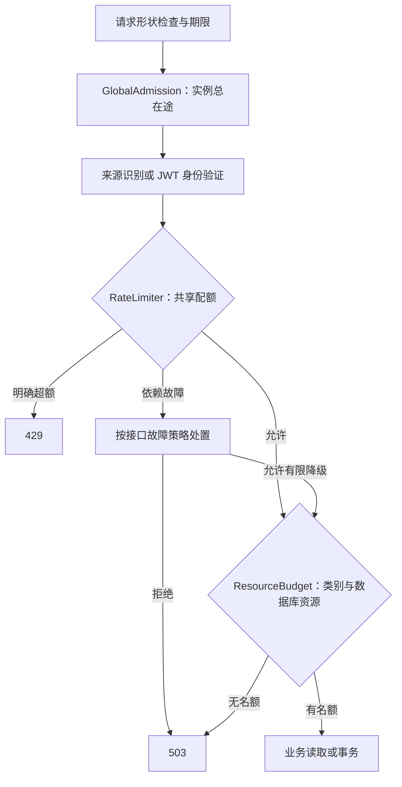

# GoPulse Redis 高并发读取保护设计

- 编写日期：2026-10-13。
- 工作分支：`re-factor/base`；源码核对基线：`4c35b395cf60d79e0e37d3d7e1c0734ca8d9cce7`。
- 状态：技术设计，作为[开发进度清单](GoPulse-Redis高并发读取保护实施方案.md)的引用依据；产品实现、性能基线及故障验收待开展。
- 范围依据：本轮评审确定的共享限流、正文缓存分层、有界回源和效果监控。
- Phase 1～3 是本文的技术分组，开发顺序和状态统一由进度清单维护；不占用仓库历史 Phase 编号，不改写已有实验 Profile、版本或验收结果。

## 1. 目标与工程边界

本轮将 Redis 的职责收敛为共享请求配额和版本化正文读取加速。主要收益指标是**相同负载与资源预算下，单位成功业务请求的数据库工作量下降，同时有效吞吐和尾延迟满足预算**。缓存命中率用于解释效果，不单独作为成功标准。

方案细化[高并发架构设计](<../../docs/GoPulse 高并发架构设计.md>)中的 B1、B5、B9、B10，衔接[可观测架构设计](<../../docs/GoPulse 可观测架构设计.md>)中的资源、指标和实验合同，以及[目标架构落地大纲](GoPulse-目标架构落地大纲.md)的 A7/A8/A10/A11 验收方向。两份顶层设计及落地大纲继续保留原冻结基线；本方案描述本轮实施范围。

| 本轮强制交付 | 解决的问题 |
| --- | --- |
| Redis 共享令牌桶、路由策略及明确故障行为 | 多个 Backend 不能各自放大同一调用者的配额 |
| 正文与动态信息分离、请求内固定 Epoch/版本 | 热门互动不再使未变化的正文反复失效，旧回填不污染新正文 |
| 同键合并、回源名额、等待人数与期限 | 冷缓存及 Redis 故障时数据库压力和等待内存有界 |
| 读取成本优化、业务指标、可复核对照实验 | 证明缓存减少了实际数据库工作量 |

异步统计投影、用户公开资料缓存和通用负缓存是条件触发项，不作为三个阶段的前置条件或强制产物。本轮计数仍从 MySQL 读取；不修改 Outbox、RabbitMQ、关系幂等、父记录锁及删除生命周期，不增加分布式重建锁、动态预算控制面、Redis Cluster 或新的信息流业务。

首轮正文缓存改造覆盖帖子详情读取，以及编辑响应中复用的详情装配。列表、搜索和关注流保留现有分页与读取合同，只做与本轮直接相关的批量查询复用和回归，避免扩展成全业务读模型重写。

## 2. 现状依据与读取成本

下列结论来自上述源码基线，属于结构核对，不代表已经测得的瓶颈。

| 现状 | 源码入口 | 实施后果 |
| --- | --- | --- |
| apiAdmission 是进程内 channel 总并发阀，饱和返回 503 | [http/router.go](../../backend/internal/http/router.go#L118) | 保留；跨实例配额和细分资源名额均为新增能力 |
| 缓存未命中／读取失败直接查询 MySQL | [post/service.go](../../backend/internal/post/service.go#L86) | 增加受控回源，不把 Redis 故障转换成全量直查 |
| PublicProjection 包含正文、作者和互动计数 | [post/cache.go](../../backend/internal/post/cache.go#L18) | 拆分正文与动态信息 |
| 点赞、取消点赞和评论创建使整份详情缓存失效 | [like/service.go](../../backend/internal/like/service.go#L44)、[comment/service.go](../../backend/internal/comment/service.go#L43) | 新正文缓存不接收互动失效；兼容期仍维护旧详情失效 |
| 缓存命中仍查询内容版本及作者、个人关系 | [post/service.go](../../backend/internal/post/service.go#L104) | 将全部数据库工作纳入成本模型 |
| CurrentEpoch 通过 Current 查询 MySQL | [businessstate/identity.go](../../backend/internal/businessstate/identity.go#L54) | Get/Set 不再分别解析 Epoch |
| 当前公共详情 SQL 含作者连接和两个 COUNT 子查询 | [post/repository.go](../../backend/internal/post/repository.go#L77) | 正文加载只取正文；动态查询需单独评估扫描与占用 |
| Redis 缓存适配器在 Get/Set/Invalidate 中各自获取 Epoch | [redis/post_detail.go](../../backend/internal/platform/redis/post_detail.go#L70) | 新接口显式接收完整 BodyKey，禁止内部重新解析 Epoch |

正常已登录请求在当前装配下的静态调用数如下。COUNT 子查询计入一条 SQL 的执行工作，不能只按语句条数忽略它们。

| 当前路径 | MySQL 调用构成 | 静态估计 |
| --- | --- | --- |
| 有效缓存命中 | Epoch、内容版本、点赞、作者、关注、收藏 | 6 条 |
| 缓存未命中并成功回填 | Get 的 Epoch、公共详情、Set 的 Epoch、四项装配 | 7 条 |
| 命中但版本不符、失效并回填 | Get 的 Epoch、版本、Invalidate 的 Epoch、公共详情、Set 的 Epoch、四项装配 | 9 条 |

这些数字在 Phase 1 通过实际请求计数验证，异常和匿名路径分别记录，不将估计值当作实测结果。

Phase 1 建立读取成本表，覆盖暖命中、冷缓存、版本变化、Redis 超时、数据库失败和正常互动。每条路径记录 SQL 操作数、耗时、扫描行／返回字节、连接池等待、Redis 调用数和重建工作。拒绝、超时与失败产生的数据库成本也单独计入，避免只统计存活的成功请求。

Phase 2 前先确定拆分后的查询形状与预期成本。正文移出缓存对象后，每次命中也可能新增 COUNT 工作；此成本必须在评审表中出现。若新路径超出冻结预算，只交付关闭状态的实现，完成 Phase 3 优化后再启用。

## 3. 最小组件与资源边界

| 组件 | 职责与范围 | 不承担的职责 |
| --- | --- | --- |
| GlobalAdmission | 当前实例全部业务 API 的在途上限，沿用现有总并发阀及探针豁免 | 名称中的 Global 指进程内全部业务请求，不是集群全局并发 |
| RateLimiter | Redis 共享的用户／来源／路由策略请求额度 | 数据库容量分配、事务幂等、用户授权 |
| ResourceBudget | 本实例认证、常规读、写入及数据库访问的静态有限名额 | 自动扩容、动态跨实例调度 |
| RebuildCoordinator | 同一 BodyKey 的共享加载、回源及等待者限制、生命周期清理 | 个性化响应共享、异步统计生产、分布式锁 |



所有名额先采用有限、非阻塞申请，拿不到立即返回容量错误，不新增通用等待队列。认证单独保护密码计算；常规读与写入有明确名额。共享池中的数据库访问需有总上限，正文重建另有更小的回源上限。探针、后台角色及恢复预留通过环境合同计入，不依赖用户配额。

对访问同一物理 MySQL 的全部运行角色，冻结：

```text
Σ(N_role × PoolMax_role) + C_reserve ≤ C_mysql_safe
Σ(N_business_api_max × RebuildMax_per_instance) ≤ RebuildTotal_safe
```

N 包含滚动发布重叠实例，连接总量包括业务 API、平台、dispatcher、消费者、维护和工具；预留只计一次。C_mysql_safe 来自指定工作负载的实测，不能直接使用 max_connections。现有配置中的副本数检查不能代替全部角色的预算汇总。

ResourceBudget 不创建额外数据库连接池。每次 SQL／事务遵循固定申请顺序，完成 Scan、Rows.Close 或事务结束才释放数据库名额；不在持有数据库名额时等待 Redis。共享加载执行者申请回源及数据库名额，等待者不重复占回源名额。编辑响应所需的逻辑装配名额在事务前预留，但不提前持有数据库连接；提交后先释放事务资源，再按需访问数据库，避免嵌套占用导致死锁。

编辑已经提交但响应装配失败时，记录提交完成和响应失败两个事实，不能将其记作“事务未开始”或安全可重放的写入。前端只可有界重读当前帖子状态，不自动重试 PATCH；本轮不因此扩展编辑命令幂等，状态重读也不作为具体命令提交成功的证明。该路径纳入错误兼容和 R08 验收。

## 4. Phase 1：性能基线与共享限流

### 4.1 配额模型与接入

采用 Hash + Lua 令牌桶：身份 Key 保存 tokens 和 last_refill_ms；脚本原子完成补充、判断、扣除和空闲 TTL。生产计算使用 Redis TIME，统一多个 Backend 的时间来源；时间倒退时 elapsed 取非负值，存储时间不倒退。脚本只执行固定数量的操作，不扫描 Key。[Redis 令牌桶说明](https://redis.io/tutorials/howtos/ratelimiting/)、[TIME](https://redis.io/docs/latest/commands/time/)、[脚本原子执行](https://redis.io/docs/latest/develop/programmability/eval-intro/)。

```text
gopulse:rl:v1:interaction_like:user:<user_id>
gopulse:rl:v1:post_read:user:<user_id>
gopulse:rl:v1:auth_source:ip:<normalized_source>
gopulse:rl:v1:login_attempt:subject:<normalized_identity_and_source_digest>
```

策略绑定实际路由，例如 PUT/DELETE /api/v1/posts/:postId/like 共用 interaction_like。已登录额度使用验证后的用户 ID；原始 URL、帖子 ID、未验证 JWT 和任意请求头不参与策略名称。策略／规则修订写入有效配置记录，普通滚动期间保持一致，不借切换 Key 前缀给所有身份重置额度。

注册、登录采用较宽的来源额度、适用的登录身份与来源组合额度，以及独立认证计算名额。登录名规范化沿用现有业务规则，摘要固定长度，密码和凭据不进入 Key 或指标。账户额度不形成永久锁号。Phase 1 用共享出口、多正常账号和异常账号混合流量验证误拒绝预算，不能只测试单 IP 单用户。

每条策略明确容量 B、补充速率 r、请求成本 c、空闲 TTL 和故障模式。要求 r > 0、0 < c ≤ B，TTL 至少覆盖空桶补满时间并有余量。稳定规则、状态不丢失条件下，同一桶在长度 t 的窗口内放行的总成本不超过 B + r×t。

明确额度耗尽返回 429 rate_limited，Retry-After 按缺口计算并向上取整。用户端可见限流错误沿用现有 JSON 错误封装；服务端不在配额接口等待令牌补充。

### 4.2 Key、内存与调用预算

只有配置登记的有限策略可以创建 Key。每条策略设置新身份 Key 的创建速率上限，可通过固定策略级创建桶与身份桶在同一次短脚本中检查；创建预算不足返回 503，不能伪装成该用户超额。当前目标是单共享 Redis 主节点，两键脚本不承诺 Redis Cluster 兼容。

首轮共用 Redis 时冻结整体 maxmemory 和 noeviction 配置、限流活跃身份规模、新 Key 速率及缓存空间余量。noeviction 避免内存淘汰直接重置配额；OOM 作为依赖故障处理，缓存回填失败仍受回源预算保护。TTL 和速率限制不构成独立键空间硬内存隔离，需记录实际 Key 数和内存高水位。若共享内存无法满足额度与缓存预算，才触发独立限流实例。

限流客户端与缓存客户端可以使用同一 Redis 地址，但分别配置有限连接池、在途调用和时间预算，所有连接总量一起核对。不同逻辑 DB 不隔离进程内存和故障。限流状态可能因重启、恢复或主节点状态丢失而重置，首轮不承诺故障期间的严格全局配额。[Redis 内存与淘汰](https://redis.io/docs/latest/develop/reference/eviction/)。

配额调用不得因结果未知而自动反复执行脚本；明确 NOSCRIPT 时可在剩余期限内回退加载／执行，网络超时则按故障策略处理。请求期限、池等待、socket 读写与重试配置均通过真实连接挂起测试核对，不能只看到 context.WithTimeout 就认为调用已被约束。

### 4.3 明确故障策略

| 接口类别 | 共享限流超时／断连／OOM | 始终保留的保护 |
| --- | --- | --- |
| 注册、登录 | 503 rate_limit_unavailable；正常用户也会受影响，这是本轮选定的可用性取舍 | 总在途、认证计算、数据库预算 |
| 发帖、编辑、删除、评论、点赞、收藏、关注等事实写入 | 事务开始前返回 503 rate_limit_unavailable，不产生业务写入 | 写入及数据库预算、已有事实幂等 |
| 常规业务读取 | 切换到有容量与过期上限的本地额度状态；达到本地状态容量时拒绝新身份 | 常规读、数据库、正文回源及等待预算 |
| 探针／服务排空 | 不走用户配额 | 原有独立保护和生命周期 |
| 平台管理、内部接口 | 保留现有角色装配与授权；本轮不引入业务 Redis 依赖 | 各自原有容量及共享数据库预算 |

降级额度按允许的最大副本数静态分配；节点预算之和受环境合同约束。降级不能保证每个身份的实时共享精度，指标必须区分 shared/local 模式；ResourceBudget 用于守住后端容量。

仅增加每实例有限的短期故障状态、跳过期限及单个恢复探测名额。探测失败延长有界冷却，成功后回到共享配额；缓存与配额分别决定故障行为。不增加自动故障转移控制面，也不因配额运行时故障把可预算降级的全部读取一并摘除。

### 4.4 阶段产物与进入下一阶段的条件

交付基线读取成本表、覆盖路由的策略表、有效配置／资源合同、Redis 适配器与 Gin 中间件、有限本地降级、配额／数据库指标和双实例故障报告。新机制先关闭上线，再按冻结配置启用。

验收包括跨实例共用同一桶、补充及空闲过期、共享出口误拒绝、伪造转发头、非法身份、新 Key 洪峰、OOM、连接挂起和本地状态容量耗尽。故障拒绝不得开始事务，读取降级不得绕过资源名额。基线及 Phase 2 成本模型完成、参数和错误合同冻结后进入 Phase 2。

## 5. Phase 2：正文缓存重构与有界回源

### 5.1 固定请求内读取上下文

新增请求读取上下文 ReadContext：Epoch、PostID、ContentRevision、AuthorID、可见性及校验时点。通过主库上的短查询获取，同一次尝试内保持不可变。不得使用请求开始前已持有的旧事务快照或滞后读副本来证明当前版本。

接口形状建议如下；具体 Go 命名可按现有领域接口收敛，但完整键必须由调用方传入：

```go
type BodyKey struct {
    Epoch           string
    PostID          uint64
    ContentRevision uint64
}

// Body 只包含正文及由内容版本覆盖的元数据。
type BodyCache interface {
    Get(ctx context.Context, key BodyKey) (Body, bool, error)
    Set(ctx context.Context, key BodyKey, body Body) error
}
```

Get、Set、回源和同键合并使用同一个 BodyKey。新缓存适配器不注入 EpochProvider，不在回填时调用 CurrentEpoch。公共正文不得包含展示计数、作者可变资料或 viewer-specific 字段；缓存值校验 ID、内容版本和必要字段，AuthorID 与权威上下文一致。

```text
gopulse:post:body:v2:epoch:<epoch>:post:<id>:rev:<revision>
TTL = base_ttl × random(1 - jitter_ratio, 1 + jitter_ratio)
```

抖动区间有上下限且 TTL 始终为正。保留当前 5 分钟作为初始研究值；具体 base_ttl、抖动及内存余量由阶段合同确定，旧版本正文自然过期，不执行全量 Key 扫描。

### 5.2 明确并发编辑、删除和恢复合同

写入在主库提交后开始的新请求，权威校验读取当前已提交状态；删除后新请求返回 404，编辑后新请求使用新的内容版本。校验前已开始并与写入重叠的请求，可以返回其校验时可见的完整旧正文版本，不承诺响应发送时仍是最新版本。动态字段在各自 SQL 的读取时点有效，不宣称整个页面是跨多次查询的单一快照。

正文回源查询限定预期 Epoch 和内容版本，只读取匹配版本的正文。若版本／代际已变化或正文已消失，本次尝试返回受控读取失败，不将不同版本的正文装入旧上下文，不在同一请求中重新绑定 Epoch/版本。版本化 Key 防止旧写入覆盖新键，不能单独证明全页面强一致。

恢复沿用环境恢复入口的停准入、排空／停止业务进程和新代际激活流程。本轮不实现在线 Epoch 切换。排空必须覆盖仍在运行的共享重建及其 SQL／回填；超期任务取消并确认进程停止后才能切换数据。新实例重新验证业务环境，旧 Epoch 的正文不得进入新键空间。该前置条件无法核实的环境不得启用新读取路径。

### 5.3 同键合并、回源和等待者控制

按完整 BodyKey 合并同实例调用。共享加载只返回 Body，动态信息及个人状态各请求独立读取／装配。singleflight 只提供重复调用合并，外围限制由 RebuildCoordinator 承担。[singleflight 文档](https://pkg.go.dev/golang.org/x/sync/singleflight)。

```text
读取权威上下文，确认可见
→ 检查对应版本正文缓存
→ 未命中／无效／访问故障：注册有界同键加载
→ 执行者再检查一次缓存
→ 仍未命中：非阻塞申请回源名额、再申请数据库名额
→ 读取预期版本正文，释放数据库名额
→ 按原 BodyKey 回填，发布共享结果，清理本轮登记
→ 各请求装配自己的动态信息并返回
```

必须同时限制活跃重建 Key 数、回源执行数、每键注册等待者、全局注册等待者、单请求等待时间和共享任务总期限。取消请求可以立即退出，但 singleflight 内部仍保留的该轮通道登记必须计入预算，不能反复加入／取消后无限增长；该轮结束统一清理。常规路径不调用 Forget 制造重复加载。

共享任务由服务生命周期上下文和独立有限期限管理，首个请求取消不取消其他请求的加载；服务排空会取消并等待共享任务。每个请求独立等待自己的剩余期限。执行者不重复申请会被等待者耗尽的请求类别名额，只申请重建及数据库资源。

无名额时立即返回 503 backend_busy。共享任务期限耗尽或预期版本改变时返回 503 post_read_unavailable，原因写入固定枚举日志／指标；只有权威查询确认不存在才返回 404 post_not_found。请求自身取消不伪造成功响应。Redis Set 失败可返回已经合法读取的正文，但记录回填失败；MySQL 权威校验失败不得用未经验证的缓存正文成功响应。

### 5.4 动态信息与兼容迁移

点赞／评论计数仍来自 MySQL，在同一统计查询快照内读取；作者公开资料和个人关系沿用权威查询。SQL 失败不能将未知计数填为零。现有 v1 缓存计数可能陈旧，需在对照实验中记录其业务质量，不能将不满足同一新鲜度条件的响应算作可比 goodput。

点赞和评论提交后，新路径不删除 v2 正文；编辑使用新的内容版本，删除由权威可见性阻断。兼容期保留对 v1 详情键的失效，覆盖所有互动及编辑／删除入口，即使新实例已使用 v2，也不能让仍运行的旧实例一直读旧计数。

迁移顺序：新增接口及关闭状态的 v2 路径 → 正确性／成本预检 → 按实例启用 → 混合实例回归 → Phase 3 性能验收 → 退役旧缓存逻辑。回退前重新核对预算，恢复 v1 写后失效，并将其旧值作冷缓存处理；不得把 v2 对象解码成 v1，不能把“关闭缓存”当成无限回源的回退方式。

本阶段必须证明上下文、字段隔离、旧回填、互动不失效正文、冷键容量和等待内存边界。启用受性能预算约束；不能因为功能测试通过就忽略新增计数查询的压力。

## 6. Phase 3：读取优化与性能验收

### 6.1 查询优化顺序

优先验证一条不包含 title/content 大字段的窄详情查询：在同一主库语句中取得环境 Epoch／状态、帖子版本、作者公开字段、两个 COUNT 和个人关系。环境不存在／不可用与帖子不存在分别解码，不能因为 JOIN 缺行而误报 404。暖命中目标形状为一条上下文／动态查询，冷缓存再加一条版本限定的正文查询；这是待验证方案，不是容量结论。

若该查询在代表性数据上扫描或连接占用过重，改为有限的上下文查询与动态批量查询，保留固定 BodyKey，按实际数据库成本选择。不得为减少语句条数强行制造昂贵大 JOIN。批量查询去重 IDs、限定集合大小，复用现有作者／收藏／关注接口，不逐帖子循环加载，不通过无限并行耗尽连接。

Epoch 优先合并进请求读取查询，避免新建进程内长期 Epoch 缓存与刷新协议。计数索引、COUNT 扫描、执行计划、个人关系唯一索引和作者读取成本逐项评估。保持成功响应字段及关系语义；若 MySQL COUNT 成本使正文分层无法满足预算，停止启用并记录统计投影触发证据。

### 6.2 指标与实验口径

| 指标 | 口径 |
| --- | --- |
| cache_requests_total | 正文缓存读取 hit/miss/invalid/error；只有键与值符合权威上下文才计 hit |
| cache_origin_total、cache_origin_duration_seconds | 正文数据库加载次数及耗时，区分成功、失败和版本变化 |
| cache_rebuild_in_flight、cache_waiters、cache_registered_waiters | 执行、活跃等待和该轮保留登记分别统计，验证取消后的内存边界 |
| rate_limit_decisions_total | 固定 policy、shared/local 模式及 allow/deny/error，不使用用户或 IP 标签 |
| resource_rejected_total | 固定资源种类及拒绝原因，区分配额超额与容量不足 |
| db_operations_total、db_operation_duration_seconds | 固定业务操作、结果；请求关联用于计算各读取路径成本，不将原始 SQL 放入标签 |
| 连接池与数据库指标 | WaitCount/WaitDuration、InUse、MySQL QPS/CPU/扫描行，全部角色和连接池覆盖 |

指标名称为拟新增业务族，实现时统一加组件前缀、注册单位／合法维度，并更新现有组件目录及查询白名单。直连指标可以作为原始证据；完整观测链路可用时一并验证。监控出口失败不阻塞业务，request_id、post_id 和用户身份只用于受限日志／Trace。

记录每个成功请求的 SQL 数与 SQL 调用累计耗时，同时报告所有已准入／失败请求的成本。Query/Scan 耗时不直接等同连接持有时间；连接池等待单独展示，可用 InUse 的时间积分估计窗口内连接占用，但必须说明采样和后台工作归属。SQL 次数下降而扫描、COUNT 或锁等待上升不能算通过。

### 6.3 固定对照实验与门槛

Phase 1 冻结资源、候选及负载合同：代码／配置修订、所有角色实例、滚动重叠、连接与在途预算、Redis 内存策略、数据规模、正文大小、热点比例、账号分布、读写比例、暖／冷缓存状态、窗口、重复次数及工具资源。只允许候选实现按预定矩阵变化，其余条件相同。

采用三组候选：A 为现有读取路径加相同成本采样；B 为共享限流及资源保护加现有缓存；C 为上述保护加新正文／优化读取。合法负载性能窗口不得通过降低用户额度制造更多 429 来获得更好延迟。异常配额及故障窗口独立报告，不能混入正常吞吐收益。

| 主要指标 | Phase 1 记录与冻结 | 最终通过条件 |
| --- | --- | --- |
| 单位成功详情的 SQL 数、累计耗时、扫描／字节和连接占用 | 路径分布及基线；冻结目标收益 δ_db、允许波动 ε_db | 次数减少或有证据表明查询更轻，目标工作负载数据库工作量达到 δ_db |
| MySQL QPS、CPU、连接池等待 | 冻结安全上限和可接受波动 | 不因拆分显著增加，不超过安全预算；正常暖读不能被热点收益掩盖 |
| 正常 goodput | 冻结合法成功及时间合同、最低值 G_min | 提高或保持在约定误差内，不能以更多拒绝替代正常业务 |
| 成功 P95/P99、错误及拒绝率 | 冻结 L95/L99、E_max/R_max | 均满足限额；成功、拒绝、失败分别报告 |
| 正文有效命中、重建／等待上限 | 记录基线及资源配置 | 可解释数据库收益，任何时刻不超冻结资源上限 |
| 故障恢复 | 冻结拒绝范围、探测周期、恢复期限 | 有限探测恢复，MySQL 与等待内存仍受控 |

阈值的具体数值在基线完成后、候选性能实验前填入有效合同，附单位、依据和修订；不得实验结束后放宽。尚无基线时不填造 QPS 或固定提升百分比。正常暖读及热点互动分别通过；如果只能证明故障保护，则只登记保护能力，不能宣布读取加速达标。

复用现有 loadtest 的到达率调度、槽位／终态记录和证据格式。当前 [load CLI](../../loadtest/cmd/load/main.go)绑定历史 Profile，且[工作负载校验](../../loadtest/internal/load/workload.go)固定路线和比例：本轮新热点／故障场景需新增独立实验合同或兼容入口并测试，不能改写历史 schema 或编造 --rate 等现有入口不支持的参数。现有 business-fault-proxy 是 HTTP 夹具，不能当作 Redis 协议故障代理；Redis 延迟／挂起测试另用受控网络夹具或独立依赖实例。

## 7. 实施映射与阶段验收

| 改动入口 | 工作内容 | 阶段 |
| --- | --- | --- |
| backend/internal/http/router.go、api.go、middleware | 保留总阀；接入请求期限、来源／用户策略、类别容量，保留探针和授权 | 1 |
| 新增 backend/internal/ratelimit 及 Redis 适配器 | 窄配额接口、Hash + Lua、创建预算、有限降级与恢复探测 | 1 |
| backend/internal/config、cmd/server/roles.go、deploy/compose.yaml | 角色装配、有限预算、共享 Redis 内存配置及启用开关 | 1～2 |
| backend/internal/post、platform/redis | ReadContext／BodyKey、新正文查询与缓存、受控同键加载 | 2～3 |
| backend/internal/like/service.go、comment/service.go、post/edit.go、delete.go | 兼容期只维护 v1 失效；新正文不因互动失效；写入响应重用预算 | 2 |
| componentmetrics、backend/internal/metricquery、backend/api/openapi.yaml | 指标目录、质量／错误映射、429/503 与前端兼容 | 1～3 |
| loadtest、acceptance 的适用测试入口 | 独立热点／故障合同、真实依赖集成、候选及原始结果绑定 | 1～3 |

只新增实现所需的窄模块，不抽象通用缓存平台。每阶段按实际改动运行单元、race、Redis/MySQL 集成及路由回归；真实竞态用屏障构造，性能验收用固定合同到达率，不拿单元测试的调用次数代替压测收益。

| 验收编号 | 场景与必须证明的结果 | 阶段 |
| --- | --- | --- |
| R01 | 同一身份并发访问两个 Backend，稳定时间窗口总成本满足 B+r×t；新 Key 创建预算、规则一致及空闲过期正确 | 1 |
| R02 | 多正常账号共享出口、伪造代理头、异常登录名洪峰；合法流量误拒绝及 Key/内存符合预算 | 1 |
| R03 | 配额超时、断连、OOM；写请求事务未开始，读请求明确降级且仍受类别／数据库名额控制 | 1 |
| R04 | 多用户访问同一冷版本，各实例每轮只有一个正文加载；首个请求取消不影响其他等待者 | 2 |
| R05 | 大量不同冷 Key、重复加入后取消、全部等待者取消、服务排空；登记、任务、等待内存和 SQL 有界且清理 | 2 |
| R06 | 暖缓存下持续点赞／评论，v2 正文不失效；动态计数和不同用户个人状态符合读取合同 | 2 |
| R07 | 旧正文加载停住后编辑提交，旧回填只进旧键；删除提交后开始的新请求 404，MySQL 不可用不返回未经校验正文 | 2 |
| R08 | Epoch A 重建与恢复排空重叠，切到 B 后不回填到 B 或返回混合数据；混合 v1/v2及回退正常；编辑提交后响应失败不触发自动重放 | 2 |
| R09 | 暖／冷、均匀／热点、Redis 故障及恢复的双实例对照；goodput、尾延迟、数据库工作与拒绝均满足预定门槛 | 3 |

成本证据至少保存环境与配置快照、候选修订、负载／数据绑定、请求终态、业务事实校验、指标原始样本、SQL 计划／扫描证据、故障施加及恢复时刻、对照报告。测试清理仅操作实验归属资源，原始失败结果保留。

## 8. 参数冻结、启用与条件触发

| 参数组 | 必须确定的值 | 冻结时点 |
| --- | --- | --- |
| 共享配额 | 每路由 B/r/c、身份规则、TTL、新 Key 速率、429 重试时间、故障模式 | Phase 1 启用前 |
| 资源 | 最大实例及重叠、各角色连接池、认证／读取／写入／数据库名额、总回源预算 | Phase 1 启用前 |
| Redis 调用 | 内存上限／策略、客户端总连接、调用并发、池／socket／总期限、探测及跳过时间 | Phase 1 启用前 |
| 正文重建 | TTL／抖动、活跃 Key 数、回源数、每键／全局登记数、等待及共享总期限 | Phase 2 启用前 |
| 读取合同 | 上下文取得方式、动态统计语义、版本变化错误、恢复排空证明、兼容／回退方式 | Phase 2 启用前 |
| 性能 | δ_db/ε_db、G_min、L95/L99、E_max/R_max、窗口／重复／故障恢复期限 | Phase 1 基线后、候选性能实验前 |

所有值通过已有配置入口及实验合同登记，启动校验范围、单位和角色适用性；保护机制启用时缺少必要预算则拒绝配置。扩实例、改额度／连接或内存策略必须重新核对总量，不创建逐请求依赖实验平台的配置查询。

阶段完成分别登记实现、正确性验收和性能能力，保持新机制可关闭、版本键空间明确及回退仍有预算。Phase 2 的关闭实现可以先合并；默认启用及旧实现退役必须等性能与兼容门槛满足。本文完成不改变[总体进度](../status/progress.md)中的产品完成状态。

| 条件触发项 | 启动证据及新增前置条件 |
| --- | --- |
| 异步统计投影 | 计数扫描／连接占用已成为实测主要限制；另立方案，补完整事实流、同一基线、原子去重／计数、乱序和校准，不扩入本轮 |
| 用户公开资料缓存 | 作者查询在优化后仍占主要读取成本；定义公开字段、更新失效和陈旧预算，不缓存权限事实 |
| 通用负缓存 | 不存在 ID 压力在配额及读取预算内仍显著；先确定短期 404 陈旧是否允许，再设计 Key／内存硬边界；故障不缓存成不存在 |
| 独立限流 Redis | 共享内存或故障范围无法满足已冻结配额与缓存预算；另冻结实例资源和状态丢失语义 |
| 跨实例重建协调 | 本地合并及静态总回源预算后，重复正文加载仍构成实测限制；另设计租约、失败、版本与恢复，不直接加锁 |

每个触发项都需有具体成本证据与独立验收合同。本轮完成标准是三阶段的强制交付及 R01～R09 在声明条件下通过，不能用增加 Redis Key 数量替代效果证明。
