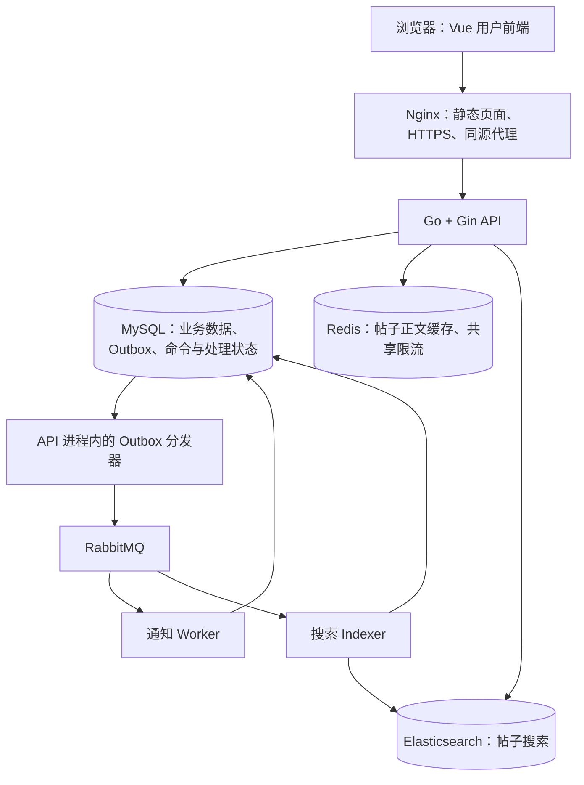

# 项目分层

GoPulse 采用前后端分离架构。后端按业务模块组织代码，API、通知 Worker 和搜索 Indexer 分别运行，共用一个 Go 模块。

## 仓库与模块

| 路径 | 职责 |
| --- | --- |
| `backend/business/` | 社交业务 API、Outbox 分发、通知处理、搜索索引及数据库迁移 |
| `frontend/web/` | Vue 3、TypeScript 用户界面，包含页面、组件、业务 API 客户端、会话与路由，以及超级管理员角色管理页面 |
| `tools/ci/`、`tools/make/` | CI 模块选择、提交校验与共享构建规则 |
| `deploy/`、根 `compose.yml` | 单机容器部署说明、Nginx 配置与 Docker Compose 编排 |
| `docs/` | 技术说明和设计资料 |

模块注册以根 [Makefile](../Makefile) 的 `GO_MODULES` 和 `NPM_MODULES` 为准。业务 Go module 名称保持为 `github.com/Ray-ymq/GoPulse/backend`。

## 运行架构

MySQL 保存业务事实、事务 Outbox、命令和异步处理状态。Redis 提供帖子正文缓存和共享限流。RabbitMQ 传递业务事件。Elasticsearch 保存可从 MySQL 重建的帖子搜索索引。

前端通过同源 `/api` 访问后端，登录与注册使用后端下发的 HttpOnly 会话 Cookie。开发时由 Vite 代理 API 请求；容器部署时由 Nginx 托管静态产物，提供 HTTPS、API 同源代理和前端路由回退。

## 后端分层与依赖

以下路径均相对于 `backend/business/`。

| 路径 | 职责与约束 |
| --- | --- |
| `cmd/` | 构造并注入依赖，启动进程，通过标准库处理退出信号并关闭资源 |
| `internal/transport/http/` | 组装路由、中间件和 Handler，解析请求并编码响应；Handler 通过业务接口访问功能 |
| `internal/modules/` | 按认证、用户、帖子、评论、点赞、收藏、通知和搜索划分业务；各模块内部用 Service、Repository、Model 和校验文件区分职责 |
| `internal/modules/bus/` | 定义事件、准入和处理结果契约，不依赖其他内部包 |
| `internal/modules/businessstate/` | 管理数据 epoch、命令和持久化一致性状态，内部包依赖仅限事件契约 |
| `internal/async/outbox/` | 在业务事务内写入事件，并在事务提交后可靠分发 |
| `internal/async/worker/` | 管理消息消费、确认、重试和死信；通过事件与状态契约连接业务处理器 |
| `internal/platform/` | 提供配置、外部连接、数据库版本检查、健康检查、限流和资源预算；Redis、RabbitMQ 和帖子缓存分别由对应子包适配 |
| `internal/shared/`、`internal/logging/` | 提供公共错误、请求关联信息和基于 `slog` 的 JSON 日志 |
| `internal/testkit/` | 提供测试支持，生产代码不得依赖该目录 |

HTTP 请求主要经过 `Router → Middleware → Handler → Service → Repository`。业务模块不依赖 Gin、HTTP 适配或 Worker 运行实现。通知和搜索模块的 Processor 负责具体事件投影，消费框架负责消息运行机制。

帖子模块定义缓存接口，`platform/postcache` 实现 Redis 适配，由进程入口注入。业务模块可以在数据库事务内调用 `async/outbox`，以保留业务写入和事件落库的原子性；存储接口与实现仍可位于同一业务包。

目录和导入约束由 [architecture_test.go](../backend/business/internal/architecture_test.go) 检查。详细目录及维护入口见 [后端说明](../backend/README.md)。

## 数据与异步处理

需要发布事件的业务写入按以下顺序执行：

1. API 在同一个 MySQL 事务内写入业务数据及对应 Outbox 记录。
2. 事务提交后，API 进程中的 Outbox 分发器将事件发布到 RabbitMQ。
3. 通知 Worker 消费相关事件并写入通知；搜索 Indexer 消费帖子变更事件并更新 Elasticsearch。
4. 消费框架确认已处理消息，并按消费策略处理重试、死信和异常消息。

业务数据与 Outbox 记录共同提交，通知和搜索索引异步更新。消息可能重复投递，通知通过去重处理，搜索通过内容版本控制处理重复或乱序更新。消息发布成功与投影应用完成是不同状态，持久化一致性状态用于记录相应处理结果。

发帖使用幂等键、命令记录和数据 epoch，支持网络中断后的结果查证与原请求重试。前端保留未确认发布的内容和请求标识；具体行为见 [前端说明](../frontend/web/README.md)。HTTP 接口契约以 [OpenAPI](../backend/business/api/openapi.yaml) 为准。

## 进程与部署边界

`cmd/server`、`cmd/business-worker` 和 `cmd/search-indexer` 是三个常驻进程。`cmd/migrate` 执行数据库迁移，`cmd/search-reindex` 执行索引初始化、重建或恢复准备，`cmd/admin-role` 设置初始超级管理员；这些维护命令执行完成后退出。

单机容器部署入口为根 [compose.yml](../compose.yml) 和 [部署说明](../deploy/README.md)。Compose 编排 Nginx、业务进程及 MySQL、Redis、RabbitMQ、Elasticsearch，并在数据库迁移和搜索初始化成功后启动业务进程。

宿主机源码运行前需自行准备依赖。配置示例统一维护在根 [.env.example](../.env.example)；后端只读取进程环境变量，不会自动加载 `.env`。仓库不提供压测工具，历史压测资料不能作为当前运行入口。

`runtimekit` 和旧可观测平台已移除。配置、日志和健康检查由业务模块内的对应包提供；常驻进程保留 `/startup`、`/live`、`/health`、`/ready` 探针及退出管理。
