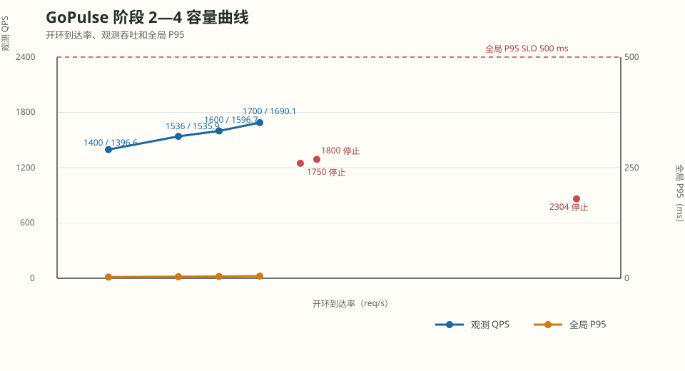

# GoPulse 阶段 2—4 容量测试报告

执行日期：2026-11-20 UTC。测试运行在 WSL2 和 Docker 中。

本报告使用当前工作区的 `tests/test-plan.md` 作为判定依据。阶段 1 的 Warm-up 数据不计入本报告。

## 1. 执行条件

- 测试工具：k6 `constant-arrival-rate`。
- 混合请求：时间线 40%、详情 20%、帖子搜索 25%、用户搜索 15%。
- 数据：1000 个用户、5000 个帖子、5000 个 Elasticsearch 文档。
- 有效会话：32 个。
- 搜索词：`cap20261119`。
- 容量测试期间临时设置 `BACKEND_RATE_LIMIT_ENABLED=false`。测试结束后已恢复为 `true`。
- 原始 512 req/s 档位的 Little 定律误差为 25.517%。该档数据作废。

原始脚本的 512 req/s 不足以形成有效的 Little 定律校验。后续测试采用 1536—2304 req/s 的开环到达率，并记录实际到达率。报告中的容量比较以到达率为主，不把到达率直接解释为实际并发数。

图中的失败档位在停止条件触发后提前结束。停止后的观测 QPS 不能作为稳定吞吐结论。

## 2. 阶梯测试结果

| 阶段 | 到达率 | 测量结果 | 全局 QPS | 全局 P95 | 错误率 | 503 率 | 峰值 throttle/min | 判定 |
| --- | ---: | --- | ---: | ---: | ---: | ---: | ---: | --- |
| 阶段 2 | 1536 | 完整 150 秒 | 1535.873 | 3.519 ms | 0% | 0% | 57.778 | 通过 |
| 阶段 2 | 2304 | 触发停止 | 859.687 | 41.008 ms | 3.241% | 2.851% | 379.756 | 作废 |
| 阶段 3 | 1600 | 完整 120 秒 | 1596.692 | 4.081 ms | 0% | 0% | 65.926 | 通过 |
| 阶段 3 | 1700 | 完整 120 秒 | 1690.142 | 4.845 ms | 0% | 0% | 99.259 | 通过 |
| 阶段 3 | 1750 | 触发停止 | 1245.083 | 6.298 ms | 0% | 0% | 123.704 | 作废 |
| 阶段 3 | 1800 | 触发停止 | 1289.492 | 5.662 ms | 0% | 0% | 122.195 | 作废 |

2304 req/s 档位首先出现错误率、503 率和 CFS throttle 超限。1750 和 1800 req/s 档位首先出现 CFS throttle 超限。短时扫描的最高通过档位为 1700 req/s。

## 3. 按接口拆分

下表使用阶段 4 的 1400 req/s、30 分钟完整运行结果。

| 接口 | 请求数 | 平均延迟 | P95 | 错误率 | 503 率 |
| --- | ---: | ---: | ---: | ---: | ---: |
| 时间线 | 1,005,584 | 1.346 ms | 1.941 ms | 0.0012% | 0% |
| 详情 | 502,792 | 1.656 ms | 2.236 ms | 0.0046% | 0.0046% |
| 帖子搜索 | 628,480 | 2.567 ms | 3.436 ms | 0.0022% | 0.0008% |
| 用户搜索 | 377,097 | 1.528 ms | 2.146 ms | 0.0008% | 0% |

阶段 4 全局结果为 2,513,953 个请求、1396.641 QPS、P95 2.804 ms、错误率 0.0021% 和 503 率 0.0011%。这些值满足当前 SLO 的延迟和错误率阈值。

## 4. Little 定律自检

| 运行 | 实际 VU 平均值 | QPS × 平均延迟 | 阶段误差 | 判定 |
| --- | ---: | ---: | ---: | --- |
| 阶段 2，1536 req/s | 3.540 | 2.938 | 17.006% | 通过 |
| 阶段 3，1600 req/s | 3.395 | 3.439 | 1.296% | 通过 |
| 阶段 3，1700 req/s | 4.664 | 4.222 | 9.477% | 通过 |
| 阶段 4，1400 req/s | 2.962 | 2.432 | 17.893% | 通过 |

阶段 4 的 10 秒窗口最大误差为 47.673%。当前后处理器按整档平均值判定 Little 定律。若要求每个 10 秒窗口都不超过 20%，阶段 4 需要重新判定为不通过。

## 5. 资源与缓存

环境快照：16 个逻辑 CPU、12968 MiB 内存、4096 MiB Swap。当前 Compose 配额为 Elasticsearch 4 CPU/4.5 GiB、Redis 1 CPU/2 GiB、MySQL 3 CPU/2.5 GiB、API 2 CPU/1 GiB、Indexer 1 CPU/1 GiB、RabbitMQ 1.5 CPU/512 MiB、Worker 1 CPU/512 MiB。

阶段 4 监控峰值如下：

| 组件或指标 | 峰值 |
| --- | ---: |
| API CPU（按配额归一化） | 48.62% |
| Elasticsearch CPU（按配额归一化） | 8.305% |
| RabbitMQ CPU（按配额归一化） | 98.6% |
| MySQL CPU（按配额归一化） | 28.423% |
| Redis 容器内存 | 14.84 MiB |
| Elasticsearch 容器内存 | 2816 MiB |
| CFS throttle | 57.805/min |
| Swap 使用量 | 592 MiB |

阶段 2—4 的高档位首先触发整体 CFS throttle。RabbitMQ 在阶段 4 的 CPU 峰值接近配额，但当前监控没有保存每个容器的 throttle 明细，不能单独确认 RabbitMQ 是 throttle 的唯一来源。Elasticsearch 没有达到 85% CPU 阈值。

阶段 4 的 Redis `used_memory` 峰值为 1,884,496 bytes。Redis keyspace hits 增量为 1,121,537，misses 增量为 8,351。Redis 有缓存访问活动，但没有达到计划要求的 500 MiB，且这些 INFO 计数不能单独证明帖子搜索缓存命中率。因此，计划中的 Redis 条件“内存大于 500 MiB 且 Elasticsearch CPU 小于 85%”未满足。

阶段 4 监控没有采集 Elasticsearch cgroup `memory.stat` 的 `file` 字段时间序列。报告不能证明 30 分钟内 page cache 的稳定性。当前结束后的单点值为 24,956,928 bytes。

## 6. 稳定性结论

1400 req/s 档位完成了 30 分钟运行，未触发 OOM、容器重启或 CFS throttle 停止条件。阶段 4 的全局 SLO 和阶段级 Little 定律检查通过。

该档位存在一次短时延迟尖峰。单个 10 秒窗口的 QPS 降至 1012.3，随后恢复到约 1400。全程 QPS 范围为 1012.3—1400.4，按全程范围计算的波动为 27.788%，不满足计划中的“波动小于 5%”。

1500 req/s 运行约 15 分钟后达到 103.704/min。1600 和 1700 req/s 运行约 82 秒后分别达到 123.659/min 和 132.439/min。因此，1700 req/s 只能作为短时通过档，不能作为 30 分钟稳定容量。

## 7. 结论与后续动作

- 短时最大通过吞吐：1690.142 req/s，目标到达率 1700 req/s。
- 30 分钟未触发停止条件的吞吐：1396.641 req/s，目标到达率 1400 req/s。
- 当前首要硬停止信号：整体 CFS throttle。
- 当前 Elasticsearch CPU 未成为首个瓶颈。
- Redis 缓存条件未满足，不能据此确认计划定义的缓存验证通过。
- 1400 req/s 的全程波动超过 5%，不能把它标记为完全通过稳定性标准。

建议下一轮先保存每个容器的 `nr_throttled` 明细，并在稳定性测试中加入 Elasticsearch `memory.stat` 的 `file` 字段。之后复测 1400—1500 req/s 区间，确认 CFS throttle 来源和稳定吞吐边界。

## 8. 原始证据

- 阶段 2：`.run/phase2-ladder-20261120T1025Z-rate1536/`
- 阶段 3：`.run/phase3-scan-20261120T1030Z/` 和 `.run/phase3-refine-20261120T1036Z-rate1750/`
- 阶段 4：`.run/phase4-stability-20261120T1100Z-rate1400/`
- 运行数据包括 `summary.json`、`metrics_10s.csv`、接口报告、资源采样、健康采样和 Elasticsearch/Redis 指标。
